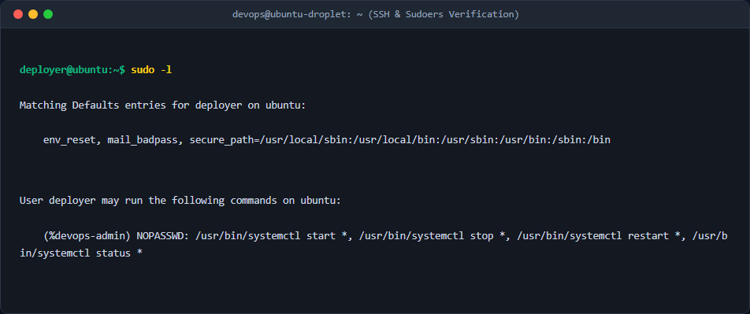
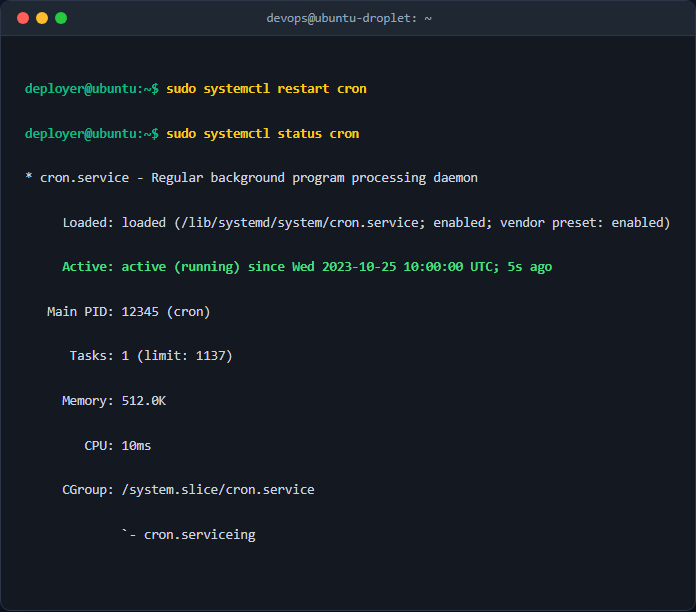

# Báo cáo kỹ thuật: Cấu hình phân quyền Nhóm và sudoers bằng visudo

## 1. Mục tiêu & Bối cảnh kỹ thuật
Tài liệu này ghi lại quy trình cấu hình phân quyền nâng cao trên hệ điều hành Linux phục vụ đội ngũ vận hành (Ops). Mục tiêu chính là cấp quyền giới hạn thực thi lệnh `systemctl` cho tài khoản tự động hóa `deployer` thuộc nhóm `devops-admin` để khởi động lại các dịch vụ hệ thống mà không cần cung cấp đặc quyền root toàn diện, tuân thủ nguyên tắc đặc quyền tối thiểu (Principle of Least Privilege).

## 2. Các bước thực hiện chi tiết

- **Bước 1: Tạo nhóm và người dùng mới**
  - Chạy lệnh `sudo groupadd devops-admin` để tạo nhóm hệ thống mới.
  - Chạy lệnh `sudo adduser deployer` để tạo tài khoản người dùng mới.
  - Chạy lệnh `sudo usermod -aG devops-admin deployer` để thêm user `deployer` vào nhóm `devops-admin` (với cờ `-a` là append và `-G` chỉ định nhóm phụ).

- **Bước 2: Cấu hình tệp `/etc/sudoers` bằng `visudo`**
  - Mở tệp cấu hình an toàn bằng lệnh `sudo visudo`.
  - Thêm dòng quy tắc phân quyền cho nhóm `%devops-admin` vào cuối tệp:
    ```text
    %devops-admin ALL=(ALL) NOPASSWD: /usr/bin/systemctl start *, /usr/bin/systemctl stop *, /usr/bin/systemctl restart *, /usr/bin/systemctl status *
    ```

## 3. Kiểm tra & Xác thực kết quả

- Chuyển sang tài khoản deployer và kiểm tra quyền sudo:


- Chạy thử lệnh quản lý dịch vụ hệ thống:


## 4. Kết luận & Best Practices bảo mật vận hành
- Việc sử dụng nhóm (`%groupname`) thay vì chỉ định từng user giúp dễ dàng scale việc quản lý phân quyền.
- Sử dụng `NOPASSWD` kết hợp với đường dẫn tuyệt đối `/usr/bin/systemctl` và giới hạn tham số giúp ngăn chặn việc leo thang đặc quyền trái phép.